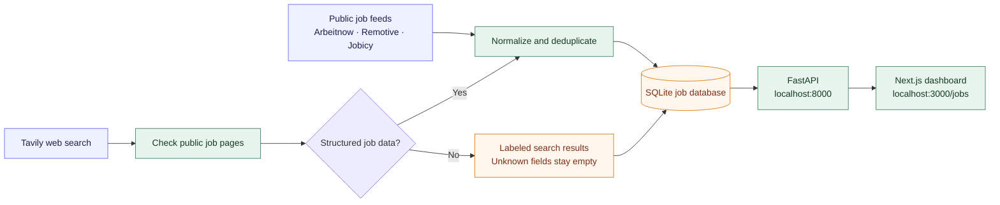
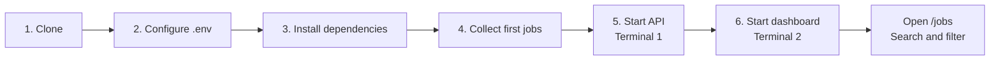

# Applyr

**Collect jobs from multiple sources. Explore them in one filterable dashboard.**

Applyr combines public job feeds and Tavily web search, removes duplicate listings, and serves
them through a Next.js dashboard backed by FastAPI and SQLite.

[Quick start](#quick-start) · [Using the dashboard](#using-the-dashboard) ·
[Everyday commands](#everyday-commands) · [Troubleshooting](#troubleshooting) ·
[API reference](#api-reference)

## What you can do

| Feature | Available now |
| --- | --- |
| Collect jobs without company-board setup | Arbeitnow, Remotive, and Jobicy public feeds |
| Discover opportunities through web search | Tavily integration with an optional API key |
| Browse and narrow down listings | Keyword, company, location, work mode, type, experience, tags, source, date, and salary filters |
| Inspect a role | Job details, original listing link, and source attribution |
| Keep search results honest | Structured job postings and incomplete search pages are labeled separately |
| Keep collected data between sessions | Local SQLite storage and refresh history |

The current project focuses on discovery and browsing. Resume tailoring, AI suitability
matching, and automatic applications are outside this version.

## How it works



A search result is not automatically an individual job. Careers indexes, blocked pages, and
pages without extractable job data remain `SEARCH_RESULT` records. The default dashboard
view shows job postings; search pages can be inspected separately.

## Prerequisites

| Tool | Version / purpose |
| --- | --- |
| [Git](https://git-scm.com/downloads) | Clone the repository |
| [Python](https://www.python.org/downloads/) | 3.12–3.14; the backend project selects 3.14 |
| [uv](https://docs.astral.sh/uv/getting-started/installation/) | Install and run the Python backend |
| [Node.js](https://nodejs.org/en/download) | Node.js 24 recommended for the dashboard |
| [pnpm](https://pnpm.io/installation) | 10.24.0 is the version used for local setup |
| Make | Optional shortcut commands on macOS/Linux; direct uv equivalents are below |

If pnpm is missing and Node.js/npm are already installed:

```sh
npm install --global pnpm@10.24.0
```

Docker, PostgreSQL, Redis, and a Tavily key are not needed to start with public feeds.

## Quick start

Already have the repository checked out? Install both apps and start them together with one
command:

```sh
./scripts/dev.py
```

The script creates `.env` if it is missing, installs the backend and frontend dependencies,
waits for the API, and runs the API and dashboard together until Ctrl-C. It uses ports 8000
and 3000; set `API_PORT` and `WEB_PORT` if those are already taken. Stop any existing dev
servers first. On a fresh database, run `make refresh` once after it starts to collect the
first listings.

The full step-by-step setup follows.



### 1. Clone the project

```sh
git clone https://github.com/wurtz-codez/applyr.git
cd applyr
```

Already have a local checkout? Start from its repository root and skip cloning.
Unless a step says otherwise, run commands below from that root.

### 2. Create local configuration

```sh
python3 scripts/bootstrap.py
```

This creates a private root `.env`, generates `API_TOKEN`, and prepares the storage directory.
An existing `.env` is preserved. On Windows, use `python` if `python3` is unavailable.

You can start with the public feeds immediately. To enable web search, add your Tavily key
to the root `.env`:

```dotenv
TAVILY_API_KEY=your_private_key
DEFAULT_SEARCH_QUERY=software engineer jobs India
SEARCH_RESULTS_PER_QUERY=10
MAX_SEARCH_REQUESTS_PER_DAY=10
ENRICH_WEB_RESULTS=true
```

Keep `API_TOKEN` as generated. The web server reads it from the root `.env` automatically;
you do not need to paste it into the dashboard. Keys stay on the server. Tavily requests may
use paid credits; the backend limits new requests and reuses cached results.

### 3. Install backend and dashboard dependencies

```sh
make install
pnpm --dir apps/web install --frozen-lockfile
```

The Makefile uses `.tools/python/bin/uv` if that existing local installation is present;
otherwise it uses `uv` from your PATH. On a fresh checkout, install uv first.

Without Make, the backend installation command is:

```sh
uv sync --project apps/api --frozen
```

### 4. Collect your first jobs

```sh
make refresh
make jobs
```

The collector uses the public feeds and includes Tavily when a key is configured. The first
refresh can take a few minutes. It prints a run summary with per-source counts and errors;
`make jobs` previews collected records in the terminal. This step does not require the API
server to be running.

Without Make:

```sh
uv run --project apps/api --frozen python -m app.cli refresh
uv run --project apps/api --frozen python -m app.cli jobs --limit 10
```

A fresh clone starts with an empty database. Run a refresh before expecting listings in the
feed. A source outage can leave partial results; check the printed summary and troubleshooting
steps below.

### 5. Start the API — terminal 1

```sh
make dev
```

Keep this terminal open. Startup creates the database and applies migrations automatically.
Confirm that http://127.0.0.1:8000/healthz returns `{"status":"ok"}`.

Without Make:

```sh
uv run --project apps/api --frozen uvicorn app.main:app --host 127.0.0.1 --port 8000 --reload --reload-dir apps/api/app
```

### 6. Start the dashboard — terminal 2

Open a second terminal at the repository root:

```sh
pnpm --dir apps/web dev
```

Keep this terminal open too, then visit:

| Page | URL |
| --- | --- |
| Landing page | http://127.0.0.1:3000 |
| Job feed | **http://127.0.0.1:3000/jobs** |
| API explorer | http://127.0.0.1:8000/docs |
| API reference | http://127.0.0.1:8000/redoc |

If Turbopack fails to start a file-event stream, use this frontend command instead:

```sh
WATCHPACK_POLLING=true pnpm --dir apps/web dev --webpack
```

That environment-variable syntax is for macOS/Linux. In PowerShell, set
`$env:WATCHPACK_POLLING="true"` before running `pnpm --dir apps/web dev --webpack`.

Press **Ctrl+C** in each server terminal to stop it. Collected jobs remain saved for the next run.

## Using the dashboard

1. Open **The feed** at `/jobs`.
2. Search for a role, company, or keyword.
3. Apply filters for location, work mode, employment type, seniority, source, tags, date, or salary.
4. Open a listing to read its description and inspect its source.
5. Follow the original-listing link to continue on the employer or job board's site.

The feed defaults to job postings. Use the listing-view selector to inspect search pages or
all records. Missing salary, location, and other fields are shown as unknown rather than inferred.
Salary filtering needs an amount, currency, and period so hourly/yearly or different currencies
are not silently mixed.

**To collect newer jobs:** run `make refresh` in another terminal, then reload the feed.
Changing filters or reloading the dashboard searches stored records; it does not launch a new
web search. Provider cooldowns may reuse the existing data instead of fetching again.

## Everyday commands

Run backend commands from the repository root:

| Command | Purpose |
| --- | --- |
| `make dev` | Start the API with code reload |
| `make refresh` | Collect jobs using the configured default sources/query |
| `make jobs` | Preview stored records in your terminal |
| `make check` | Run backend lint, tests, and the migration/schema check |
| `pnpm --dir apps/web dev` | Start the dashboard |
| `pnpm --dir apps/web typecheck` | Check frontend TypeScript |
| `pnpm --dir apps/web build --webpack` | Build the frontend locally |

For a different query or a single source:

```sh
uv run --project apps/api --frozen python -m app.cli refresh --query "backend engineer jobs India"
uv run --project apps/api --frozen python -m app.cli refresh --provider arbeitnow
uv run --project apps/api --frozen python -m app.cli jobs --q Python --limit 10
```

In this workspace, `.tools/python/bin/uv` can replace `uv`. To inspect the API directly, open
`/docs`, select **Authorize**, and enter `API_TOKEN` from `.env`.

## Configuration and storage

- **Root `.env`:** backend configuration and private API credentials.
- **`apps/web/.env.local` (optional):** copy [the web example](apps/web/.env.example) here only
  when overriding the default API address or configuring a deployment.
- **`API_BASE_URL`:** defaults to `http://127.0.0.1:8000` on the web server.
- **`storage/jobs.sqlite3`:** collected listings and refresh history; created automatically.
- **`JOBS_DATABASE_URL`:** optional database override. Run one API process for local SQLite use.

Restart the API after changing backend settings. If you change `API_TOKEN`, restart both the
API and frontend so they use the same value. Keep `.env` and local storage out of Git.

## Troubleshooting

| Symptom | What to check |
| --- | --- |
| `uv`, `pnpm`, or `make` is missing | Install the prerequisites; use the direct uv commands if Make is unavailable. |
| The feed has no jobs | Run `make refresh`, inspect its summary, then reload `/jobs`. A fresh clone has no bundled dataset. |
| The feed reports that the API is offline | Start `make dev` and check `/healthz`. Confirm `API_BASE_URL` if you changed the port. |
| The API rejects the token | Keep the same `API_TOKEN` in root `.env` and any web environment override, then restart both servers. |
| Tavily is not configured | Add `TAVILY_API_KEY` to root `.env`. Public feeds still work without it. |
| Refresh says `CACHED` or `COOLDOWN` | The source is within its refresh interval or has asked the collector to wait. Check `next_refresh_at`. |
| A source cannot be reached | Check internet/DNS access in your terminal. Other sources and previously collected jobs remain available. |
| No listings match your filters | Clear filters; unknown publication dates or salary values are excluded by those specific filters. |
| Frontend reports an FSEvent/Turbopack error | Use the Webpack polling fallback in step 6. |
| Port 3000 or 8000 is already in use | Stop your previous server instance with Ctrl+C, or configure a different port and matching `API_BASE_URL`. |

The backend currently has 28 isolated tests covering collection, filters, deduplication,
source failures, budgets, authentication, web-fetch protections, and migrations. They do not
change your stored jobs or make paid API calls.

## API reference

<details>
<summary>Endpoints, refresh requests, and backend filter parameters</summary>


All `/api/v1` routes require `Authorization: Bearer <API_TOKEN>`. In `/docs`, use **Authorize**
and paste the value from `.env`. Health and the API schema are public. The key is not returned
by any data endpoint.

| Method | Endpoint | Result |
| --- | --- | --- |
| GET | `/api/v1/jobs` | Paginated matching records and total count |
| GET | `/api/v1/jobs/{id}` | Full job detail and provenance |
| GET | `/api/v1/jobs/filters` | Available filter values and counts for the current filters |
| GET | `/api/v1/dashboard` | Counts for current filters and latest refresh |
| GET | `/api/v1/sources` | Source configuration, attribution, refresh interval and last success |
| POST | `/api/v1/discovery/runs` | Start refresh; returns 202 and a run ID |
| GET | `/api/v1/discovery/runs` | Recent refreshes |
| GET | `/api/v1/discovery/runs/{id}` | Progress, per-source counts, errors and next refresh times |

Start a refresh with a JSON body:

```json
{
  "query": "software engineer jobs India"
}
```

Omit `providers` to use configured defaults. To restrict sources, add a `providers` array;
including `tavily` requires its key to be configured. Job-list responses include short descriptions;
full descriptions are loaded from job detail. Summary counts distinguish `job_postings` from
`search_results`. `new_today` means first collected today, not necessarily published today.
All timestamps in API responses use UTC.

### Filters

Filters work together and also apply to `/jobs/filters` and `/dashboard`:

| Parameter | Meaning |
| --- | --- |
| `q` | Literal keyword search in title, company and description |
| `company` | Company name, case-insensitive exact match |
| `location` | Location text contains the value; not a country/eligibility inference |
| `work_mode` | `REMOTE`, `HYBRID`, `ONSITE`, or `UNKNOWN` |
| `employment_type` | Source-reported job type, such as `Full-time` or `Contract` |
| `experience_level` | Source-reported seniority, when available |
| `listing_type` | `JOB_POSTING` or `SEARCH_RESULT` |
| `source` | Provider; repeat for multiple providers (OR) |
| `tag` | Repeat for multiple tags; every selected tag must match (AND) |
| `posted_within_days` | Uses published date; unknown publication dates do not match |
| `seen_within_days` | Uses last observed date |
| `min_salary` | Requires both `currency` and `salary_period` |
| `currency` | Three uppercase letters, e.g. `USD` |
| `salary_period` | `hourly`, `daily`, `weekly`, `monthly`, or `yearly` |
| `sort` | `newest`, `oldest`, `title`, or `salary_desc` |
| `page`, `page_size` | Page starts at 1; at most 100 records per page |

The main jobs grid should request `listing_type=JOB_POSTING`; incomplete search leads can be
shown separately with `listing_type=SEARCH_RESULT`.

Example: `/api/v1/jobs?q=Python&work_mode=REMOTE&tag=python&listing_type=JOB_POSTING&page_size=25`.
Salary sorting also requires currency and period, so currencies and hourly/yearly amounts are
never silently mixed. Facets come from stored data rather than invented filter choices.


</details>

## Source coverage and collection limits


- Public feeds are fetched from fixed endpoints. Pagination is bounded to three pages per
  source per refresh, and truncated traversals are marked `partial`.
- Arbeitnow and Jobicy refresh at most hourly; Remotive at most every six hours. Repeated
  requests within the interval use stored data. Rate-limit responses and cooldowns are visible.
- Tavily caches the same query for 30 minutes, caps daily search requests, uses basic search,
  disables automatic provider parameter selection, and does not request generated answers.
- At most ten search-result pages are fetched for structured extraction per query. Requests
  have deadlines and size limits. Redirects are checked, private addresses are blocked, DNS
  destinations are pinned with the original TLS hostname, and robots rules are respected.
- Descriptions must be rendered as plain text, never inserted as HTML. Missing salary, location, seniority and company are not guessed.
  A source link and attribution remain with each record.
- Source outages do not delete old jobs. Presence in the database is not proof of current
  availability; last-seen and publication dates are exposed for review.

Source data has coverage limits: Arbeitnow focuses on European markets; Remotive and Jobicy
supply remote roles. Remote location text is not proof that an India-based applicant is eligible.
Remotive's public data is delayed and requires attribution. When displaying records, show the
returned source names/links and preserve the provider's original listing link.


## Repository layout

```text
applyr/
├── apps/
│   ├── api/             # FastAPI, source adapters, database, migrations, tests
│   └── web/             # Next.js landing page, job feed, filters, job detail
├── scripts/             # Local configuration bootstrap
├── storage/             # Ignored SQLite database and private local archives
├── Makefile             # Backend development and collection commands
├── .env.example         # Safe configuration template
└── README.md
```

For frontend-specific notes, see [apps/web/README.md](apps/web/README.md).
The ignored `IMPLEMENTATION_PLAN.md` is local engineering material and is not required to run
a fresh clone. Private `storage/archive-*` folders may exist in a workspace that used the
previous implementation; they are not used by the current backend.

## Source references


[Arbeitnow API](https://www.arbeitnow.com/blog/job-board-api) ·
[Remotive API](https://github.com/remotive-com/remote-jobs-api) ·
[Jobicy API](https://github.com/Jobicy/remote-jobs-api) ·
[Tavily Search](https://docs.tavily.com/documentation/api-reference/endpoint/search) ·
[JobPosting structured data](https://developers.google.com/search/docs/appearance/structured-data/job-posting)

[MIT license](LICENSE).
