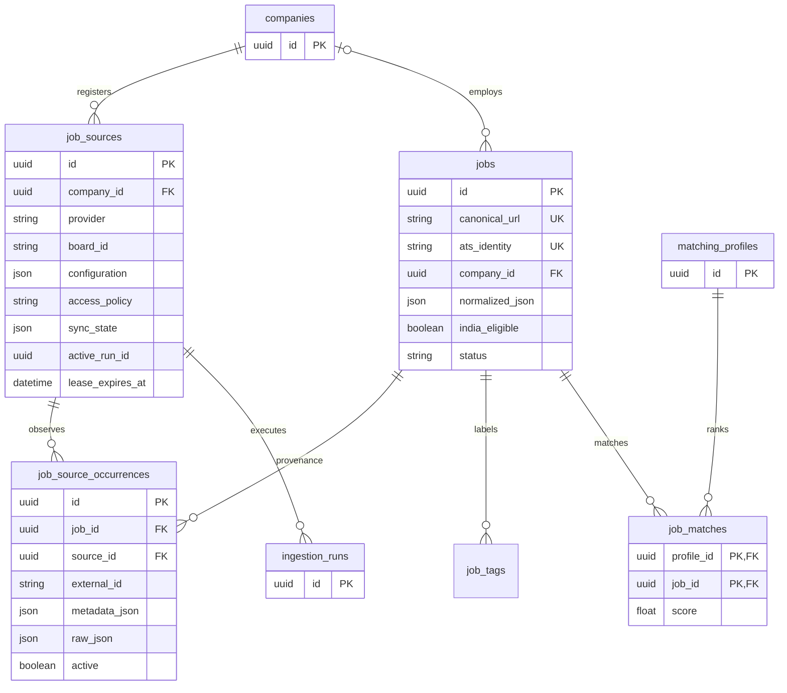

# Applyr job ingestion architecture

This document describes the implemented code, including its operational limits. Basic ingestion requires no paid keys. It provides extensible, permitted source coverage, not exhaustive internet-wide job discovery.

## 1. Repository baseline and objectives

The inspected checkout contains FastAPI, SQLAlchemy 2, PostgreSQL, Alembic, Pydantic 2, HTTPX, pytest, and a Next.js 16 / React 19 feed. Legacy collectors support Arbeitnow, Remotive, Jobicy, and optional Tavily search. They use an in-process FastAPI background task and a PostgreSQL run lock. No durable worker, user authentication service, matching table, AI matcher, or application automation implementation existed in this checkout.

The new engine keeps that ORM, database, API authentication, feed, and migrations. It adds Celery/Redis/Beat because no durable worker infrastructure existed. The API reserves runs in PostgreSQL; ingestion executes in workers. Canonical jobs remain global and independent of matching profiles.

## 2. Decisions and tradeoffs

- Extend existing `jobs`; do not create a second catalog or ORM.
- Rename the former occurrence table `job_sources` to `job_source_occurrences`, preserving its data. The new `job_sources` is the persistent company-board registry.
- Keep legacy API responses and collection commands compatible. `/sources` still returns legacy provider metadata; `/sources/registry` lists registered boards.
- Use documented public ATS endpoints. Source parsing belongs to connectors, never to the orchestrator.
- Prefer conservative identity merges, uncertain classifications, and retained provenance over aggressive deduplication or rejection.
- Store API response caches in source JSON for a practical first deployment. This avoids new blob/cache infrastructure but requires bounded boards; external cache storage and pruning are future improvements.
- Deterministic parsing and profile ranking require no LLM. Scores are a transparent baseline, not predictions of application success.

## 3. High-level architecture

```mermaid
flowchart LR
  Maintainer[Manual registration / JSON seed] --> Registry[(Companies + source registry)]
  Tavily[Optional explicit Tavily discovery] --> Suggestions[Unverified source suggestions]
  Suggestions --> Maintainer
  API[Authenticated FastAPI API] --> Runs[(Durable queued ingestion runs)]
  Beat[Celery Beat every minute] --> Dispatcher[Due sources + pending dispatch]
  Registry --> Dispatcher
  Dispatcher --> Runs
  Dispatcher --> Redis[(Redis broker)]
  Redis --> Worker[Ingestion worker]
  Worker --> Connectors[Connector registry]
  Connectors --> ATS[Public ATS APIs]
  Connectors --> Generic[Permitted HTTP / feeds / JSON-LD / HTML]
  Worker --> BrowserQueue[Separate browser queue]
  BrowserQueue --> Browser[Optional Playwright worker]
  ATS --> Normalize[Typed normalization + deterministic enrichment]
  Generic --> Normalize
  Browser --> Normalize
  Normalize --> Identity[Transactional identity deduplication]
  Identity --> Catalog[(Jobs + occurrences)]
  Identity --> History[(Run counters + source health)]
  Catalog --> Matching[Worker profile ranking]
  Matching --> Matches[(Profile-specific job matches)]
  Catalog --> API
  Matches --> API
  API --> UI[Existing feed + sources / monitoring UI]
```

## 4. Components

| Module | Responsibility |
| --- | --- |
| `app/ingestion/schemas.py` | Pydantic job/source/result contracts and connector protocol |
| `registry.py` | Named connector factories; extension point |
| `connectors/ats.py` | Four independently testable public ATS adapters |
| `http.py` | Async HTTP, pacing, conditional responses, bounded bodies, retries |
| `connectors/generic.py` | Small permitted crawls, XML links, JSON-LD, HTML, isolated browser adapter |
| `connectors/jobspy_optional.py` | Explicitly authorized optional library adapter |
| `discovery/` | Supported ATS URL detection and optional Tavily suggestions |
| `policies.py` | Access gates and configuration checks |
| `normalizer.py` | Location aliases, eligibility, experience, skills, role/seniority flags |
| `deduplicator.py` | Identity keys, PostgreSQL advisory locks, review candidates |
| `engine.py` | Durable runs, leases, pagination, storage, health and failure isolation |
| `freshness.py` | Explicit expiry, complete snapshot reconciliation, canonical status |
| `matching.py` | Independent profile ranking and match persistence |
| `workers/` | Celery configuration, scheduled dispatch, freshness and matching tasks |
| `ingestion/api.py`, `service.py`, `cli.py` | Registry operations, monitoring, seeds and maintenance |

## 5. Company and source discovery

A manual career URL can use `provider=auto`. Detection recognizes exact supported Greenhouse, Lever (including EU), Ashby, and SmartRecruiters hostnames, with validated board identifiers. Greenhouse embedded board query parameters are supported. Unsupported URLs become `career_page` sources. Greenhouse EU boards are explicitly rejected until that regional API is implemented.

Detection establishes a URL pattern, not employer identity, permission, or endpoint availability. New sources remain `unverified` until a successful ingestion validates the public endpoint response. Failed or invalid responses change health rather than inventing jobs. `pending` and `denied` policies cannot ingest. A supplied company website identifies an existing employer entity; an employer name alone does not automatically merge companies.

Permitted crawls report ATS links in `discovered_boards` metadata. Operators can register these candidates. `python -m app.ingestion.cli discover QUERY` optionally asks Tavily for supported board URLs and returns `verified=false` suggestions; it never writes jobs or enables sources. Tavily is excluded from the legacy collector's default provider list, even when a key exists. Explicit legacy Tavily calls remain available for compatibility. Automated daily discovery/approval is planned; discovery currently requires an explicit command.

Contributors submit reviewed board configuration using `config/job_sources.example.json`. Example boards are disabled initially; enabling a source is an explicit access decision. No third-party job dataset is bundled.

## 6. ATS connector behavior

| Connector | Documented endpoint | Pagination and incremental behavior |
| --- | --- | --- |
| Greenhouse | `GET https://boards-api.greenhouse.io/v1/boards/{board}/jobs` and `/jobs/{id}` | Complete board list, no invented pagination. Cache detail by list `updated_at`; fetch details only when changed or version unavailable. Use source `first_published` when present, never `updated_at` as publication. |
| Lever | `GET https://api.lever.co/v0/postings/{board}?mode=json&skip=0&limit=100` | Offset cursor; continue on full pages. EU uses `api.eu.lever.co`. Full descriptions come from the list, with conditional page requests when supported. `createdAt` is not asserted to be a publication date. |
| Ashby | `GET https://api.ashbyhq.com/posting-api/job-board/{board}` | Complete snapshot; only `isListed=true`. Use `workplaceType`, because `isRemote` also covers hybrid jobs. Preserve `publishedAt`, `jobUrl`, and `applyUrl`. |
| SmartRecruiters | `GET https://api.smartrecruiters.com/v1/companies/{board}/postings` and `/postings/{id}` | `offset`/`limit`, stop against `totalFound`; fixed-host detail URLs. Cache details by list record fingerprint. Optional documented `q`, `country`, `city`, and `department` filters. Preserve `releasedDate` and public application URL. |

The shared client uses a default one-second minimum interval per source, configurable upwards to 60 seconds. Reads have 20-second timeouts, three attempts, exponential backoff with jitter, HTTP 429 `Retry-After` handling (delta or HTTP date), and 20 MiB decoded-body limits. A delay above 30 seconds defers further work to the scheduler. No redirects, credentials, application submission, or private ATS endpoints are used.

ETag/Last-Modified are sent only when cached data is available. A valid 304 reuses that data and still updates occurrence `last_seen_at`. Providers need not support conditional headers. Greenhouse and SmartRecruiters detail caches also avoid repeated description requests when validators are unavailable. Publication timestamps remain null if not provided.

Official interfaces: [Greenhouse](https://docs.greenhouse.io/job-board), [Lever](https://github.com/lever/postings-api), [Ashby](https://developers.ashbyhq.com/docs/public-job-posting-api), [SmartRecruiters](https://developers.smartrecruiters.com/docs/endpoints). The live smoke probe successfully received HTTP 200 from all four example list endpoints during implementation. CI uses synthetic fixtures and never depends on these boards remaining available.

## 7. Job boards and generic extraction

Extraction follows explicit APIs or configured feeds first, JSON-LD next, configured selectors next, then a conservative HTML detail fallback requiring title, description, and application-link evidence. It never turns an arbitrary Careers heading into a posting.

The generic HTTP path reuses `PageFetcher` and its public-only transport: HTTPS only, public DNS/IP validation, pinned addresses, hostname-specific TLS pools, robots checks, response size and deadline bounds. Career crawls remain on the configured origin, inspect at most 20 documents, bound link queues, parse XML with defusedxml, and follow sitemap or RSS/Atom job-detail links. Set `configuration.sitemap=true` for `/sitemap.xml`; XML sitemap indexes are also traversed within the page budget. RSS/Atom currently supplies detail URLs; standalone feed-only descriptions are not normalized as complete jobs. Scrapy-scale crawling, gzip sitemap support, automatic feed discovery, and exhaustive site traversal are planned.

Robots denial, unavailable robots policy, positive crawl-delay, or request-rate directives stop access conservatively. Robots permission alone is insufficient: non-ATS sources additionally require `access_policy=permitted` and permission notes. Empty unsupported extraction is observable as `NO_JOBPOSTINGS_EXTRACTED`.

`browser` is an explicit optional fallback, not an automatic escalation after an HTTP failure. Only its dedicated queue launches Playwright. One context/page serves a run; resource requests are serialized through the same pinned, robots-checked HTTP transport. Non-GET requests, redirects, downloads, service workers, WebSockets, images, fonts and media are blocked. There are 80 resource, 2 MiB resource, 30-second navigation, and 45-second resource-fetch bounds. Run its worker with concurrency one. This restrictive adapter intentionally cannot render every JavaScript site. Browser reuse across runs and broader permitted rendering support are planned. Browser binaries and real rendering have not been verified in this environment.

JobSpy is an optional extra, disabled by default. It requires a permitted source, permission notes, `authorization_reference`, explicit `site_name`, and matching `authorized_sites`. Only allowlisted search arguments pass to the library; no proxy, bypass, credential or evasion options are exposed. Library-internal networking is outside the shared ATS HTTP utility and is bounded by the worker deadline, not a claim of fine-grained provider rate control. Restricted-platform use requires separate authorization and policy review; installing the extra grants none. Generic crawling of known restricted platform hosts is rejected. Users can supply permitted job detail URLs through the same career-page source mechanism.

## 8. Unified schema

`NormalizedJob` contains `source`, `external_id`, `company`, `title`, `description`, `location`, employment type, experience bounds/confidence/evidence, skills, original job/application URLs, requisition ID, employer publication/expiry dates, status, optional raw data, `source_fields`, and `derived` classifications. Location contains country, city, remote type, eligible applicant countries, explicit worldwide eligibility, India eligibility, confidence and evidence. Unknown facts are null; missing descriptions use the existing catalog's empty-string convention.

Source data and derived data remain distinguishable. Skill keyword detection, experience regex results, target-role flags, seniority and junior fit are deterministic derived values. Confidence values are heuristic extraction scores, not calibrated probabilities. Bangalore normalizes to Bengaluru; common Indian city aliases are recognized. Ashby secondary offices are preserved separately and can establish a non-remote India workplace. A remote office address alone does not imply applicant eligibility. Explicit applicant country requirements determine eligibility; explicit worldwide remote labels are distinct from explicit India eligibility. Unknown remote eligibility remains null. This is deliberately conservative and is not immigration or employment-law advice.

`jobs.normalized_json` stores the normalized document. Existing typed columns remain available to old clients; `first_seen_at`/`last_seen_at` are assigned at ingestion, outside the connector. `published_at` always represents employer data. The UI labels discovery and publication times separately. Original `apply_url` lives in normalized JSON and occurrence metadata; indexed `jobs.apply_url` is its canonical identity URL. Original job URLs also have their own column.

Raw archival per occurrence is opt-in with `retain_raw=true`. Response bodies used as incremental caches still live in private registry synchronization state; those are not returned by the public catalog API. Operators must review source retention and redistribution rights. Cache retention is not an independent license to republish data.

## 9. Database

Registry `(provider, board_id)` and occurrence `(source_id, external_id)` are unique. Legacy occurrences have a null registry source ID. Existing catalog indexes remain; registry company/provider/due-time, occurrence source, run status/source, job geography/experience/application/requisition and matching score indexes are added. Matching profile `user_key` is unique. PostgreSQL remains required.

Migrations: `f19d7a21` performs the preserving table rename and catalog/registry/run expansion; `b812c730` adds matching profiles and job matches; `c32ef819` adds an indexed occurrence ATS identity, including a backfill from provenance metadata. The latter avoids a full JSON scan for each new canonical job and preserves lookup of alternate ATS identities. Downgrading to the old occurrence schema collapses multiple occurrences of the same job/provider, because that old schema cannot represent them. Back up production data before a downgrade.

## 10. Deduplication

Resolution order:

1. Existing source occurrence; verified connector provider/board/external ID, or identity parsed from a supported employer ATS URL.
2. Exact canonical employer job/application URL.
3. Exact employer entity plus requisition ID.
4. Similar title with identical employer entity/location: record up to five candidate IDs for review, **never automatically merge**.

All occurrences are preserved. PostgreSQL transaction advisory locks serialize competing identity decisions across workers; unique constraints provide the final safeguard. URL canonicalization removes only known tracking parameters (`utm_*`, `gclid`, `fbclid`, mail campaign IDs), strips fragments, and sorts query parameters. It preserves meaningful IDs such as `gh_jid`, `jobId`, path case and unknown query parameters. Original links remain available.

An ingestion retry updates the existing occurrence. Tracking-only URL changes do not trigger meaningful catalog updates. ATS records take precedence over generic/aggregator records. Conflicting authoritative records can still change the canonical description; an editorial conflict-resolution workflow is planned.

## 11. Two-stage filtering and profile matching

Stage one fetches broad boards rather than issuing narrow junior keyword queries. SmartRecruiters supports explicit documented source filters. Generic feeds/pages have configured scope. The engine does not reject a role merely because its description lacks a years-of-experience phrase.

Stage two normalizes geography, detects explicit experience requirements, extracts a small technical-skill vocabulary, and marks senior/leadership titles and target software-role aliases. `/jobs` can filter geography, source, text/role, experience and status; `include_uncertain=true` is the default. Experience filtering compares minimum required years against the requested maximum, rather than inventing a maximum from `N+ years`.

Profile matching is independent: an authenticated operator registers an opaque `user_key`, skills, role aliases, maximum experience and India preference. A worker calculates a transparent 0–100 baseline: role 25, geography 20, experience 25, skills 30, with a senior-title penalty. Unknown geography/experience/skills receive partial credit and explicit reasons. Known geography mismatches for an India-only profile and closed jobs score zero. Skill gaps are recorded. Profiles never filter the global catalog during ingestion.

New or meaningfully updated jobs mark enabled profiles dirty. Beat processes dirty profiles, upserting `(profile_id, job_id)` matches and preserving catalog independence. `/jobs?match_profile=UUID&sort=match` returns profile scores/reasons; the feed accepts a profile ID and shows scores when available. Profile ranking currently scans the catalog for dirty profiles; targeted incremental ranking and AI reranking are planned. There are no paid model calls.

## 12. Scheduling and execution

- Default ATS interval: six hours, configurable per source (at least one hour).
- Beat checks due sources and dispatches queued runs every minute.
- Freshness expiry runs daily; complete snapshot reconciliation also runs after successful syncs.
- Dirty profile matching runs every minute.
- Company discovery is explicit; daily company discovery is planned.

Reservation locks a source row and returns its existing active run when one exists. A 12-minute lease prevents overlaps; expired runs become `INTERRUPTED` before replacement. Worker claim transitions only `QUEUED` to `RUNNING`, renews the lease, and sets execution start time. Duplicate deliveries are harmless. The run has a 540-second async deadline and 570/600-second Celery soft/hard limits. Queue and execution timestamps use UTC.

API requests commit run rows without contacting Redis. The dispatcher publishes pending IDs to Redis; rows remain durable through broker failure. Redis deliveries may repeat and dispatch state is not exactly-once: the PostgreSQL claim makes execution idempotent. Use one Beat instance. Workers use late acknowledgements and prefetch one. Regular workers consume `ingestion`; the optional browser worker consumes `browser` at concurrency one. Legacy discovery background tasks remain for old clients and are not advertised as durable ingestion tasks.

Each completed page commits valid jobs and counters. Later-page failure retains prior successful pages but does not replace full synchronization state or reconcile missing jobs. Synchronization begins from page zero each run, using conditional and detail caches; resuming a partially interrupted scan mid-board is planned. One source failure does not abort other source tasks.

## 13. API and frontend

All `/api/v1` routes use the existing constant-time bearer-token authentication. `/healthz` remains unauthenticated. Existing job response fields are retained; new fields are additive. Registry configuration and full caches are not exposed by listing endpoints.

| Route | Behavior |
| --- | --- |
| `GET /jobs`, `/jobs/{id}`, `/jobs/filters`, `/dashboard` | Existing catalog contracts, additive geography/experience/status/profile fields and filters |
| `GET /sources` | Existing provider metadata contract |
| `GET /sources/registry` | Paginated persistent registry and source job counts |
| `POST /sources` | Validate and register company board or permitted URL |
| `GET /sources/{id}`, `PATCH /sources/{id}` | Health/detail, policy/notes/interval, enable/disable |
| `POST /sources/{id}/sync`, `POST /ingestion/sync` | HTTP 202, durable run/task IDs; `dispatched=false` means awaiting scheduled dispatch |
| `GET /ingestion/runs`, `/ingestion/runs/{id}`, `/ingestion/stats` | Pagination, execution counters, source health and errors |
| `POST /matching/profiles`, `GET /matching/profiles` | Upsert operator-managed profile; inspect pending ranking |

Paths above have `/api/v1` prefixes. Jobs use page/page_size limits of 100; registry and history default to 25, maximum 100. Registry/history can filter source where applicable. Errors use FastAPI's `detail` envelope; new service errors carry `detail.code`, validation errors retain FastAPI's 422 array, preserving existing contracts.

The Next.js feed keeps its component/design system, adding source labels, India/junior uncertainty filters, profile scores and freshness. `/jobs/sources` adds source registration, enable/disable, manual sync, and paginated monitoring. Active runs poll backend state. Browser mutations must supply the operator token; the proxy never injects the server token into an unauthenticated mutation. The shared server token still authorizes feed reads as in the original personal self-hosted app. This is not tenant-isolated multi-user authentication; do not expose private profiles through an unprotected shared deployment. Tenant auth/RBAC is planned.

## 14. Errors, retries and health

Sources have `unverified`, `healthy`, `degraded`, or `failing` health, attempt/success times, failure count and next-fetch time. Runs have `QUEUED`, `RUNNING`, `SUCCEEDED`, `PARTIAL`, `FAILED`, or `INTERRUPTED` status. `fetched` counts normalized returned records; `inserted` counts new canonical jobs; `updated` counts changed canonical records; `deduplicated` counts newly attached occurrences of existing jobs; `failed` counts reported error conditions, including page/source errors. An invalid record need not stop valid records in a page.

Request errors and 5xx responses retry; non-429 4xx responses fail without retry. Failures defer the source with exponential backoff capped at one day, respecting longer Retry-After values. Full error code lists are capped at 100 in history. Access checks run before fetching and before each page write. Sources disabled while queued cannot ingest.

Unexpected errors are logged with run/source IDs; API responses use stable codes rather than dumping response bodies or credentials. A failed request never deletes jobs or closes occurrences.

## 15. Access and data rights

Use only supported public methods and permitted pages. Public accessibility does not establish redistribution or retention rights. Operators and contributors review provider terms, employer permission, licensing, retention and attribution, and record the appropriate policy/notes. Pending/denied sources cannot run. Changing a policy never bypasses technical restrictions. No CAPTCHA handling, authentication bypass, credential harvesting, proxy rotation or anti-bot evasion is implemented. Applicant form submission is outside this engine.

## 16. Scalability

Scale worker concurrency across independent boards, not concurrent requests against the same source. Default API fetching stays async while ORM writes use the repository's synchronous SQLAlchemy stack inside worker processes. PostgreSQL locks and constraints coordinate workers. Use request intervals appropriate to each provider and reduce global concurrency when many boards share a provider.

Current bounds: 100 ATS pages by default (configurable up to 500), 32 MiB synchronization state by default (`INGESTION_MAX_STATE_MB`, maximum 256), bounded generic crawling, paced HTTP/browser resources, request/run deadlines, source leases, page commits and isolated queues. Very large boards can exceed a run/cache budget and report partial results rather than falsely closing jobs. Generic external identifiers longer than 200 characters are stored as stable hashes, while their original URLs remain intact. Global provider-wide distributed throttling, external bounded cache retention, bulk persistence, targeted match updates, advanced candidate review and source metrics export are planned.

## 17. Observability

Inspect `/ingestion/stats`, paginated runs, source health, counts, success times and worker logs. `ingestion_finished` logs source/run IDs and outcome counts. `ingestion_dispatch_pending` indicates broker publication failure, while the database keeps the queued run. Alert on repeated failures, old queued/running rows, leases expiring, lack of successful syncs, zero-job extraction changes, and sustained 429 responses. Prometheus/OpenTelemetry exporters are planned; none is claimed to exist.

## 18. Concrete flow

An operator registers `https://jobs.ashbyhq.com/Ashby` with `provider=auto` and an affirmed public-API policy. The registry detects `ashby/Ashby` and stays unverified. Sync reserves run R and returns 202. Beat publishes R; a worker claims it and calls the public posting API. Unlisted jobs are excluded. A hybrid Bengaluru job normalizes its city to Bengaluru and its country to IN, without confusing hybrid with fully remote.

Identity `ashby:Ashby:EXTERNAL_ID` selects or inserts canonical job J. The occurrence retains board identity, original URLs and seen times. A second successful sync changes last-seen times without inserting another J or unnecessarily reranking it. A company page pointing at the same employer ATS application URL attaches another occurrence to J. Profiles rank J independently. If Ashby's API fails, J remains; closure requires explicit expiry or two complete successful absence snapshots, and another active occurrence keeps J active.

## 19. Implementation status

Implemented: four public ATS adapters, typed plugin contract, persistent registry/companies/provenance/runs, preserving migrations, deterministic normalization and identity deduplication, broad/local filtering, dirty-profile matching, durable scheduled ingestion, retries/conditional caches, health/history APIs, permitted JSON-LD/HTML/XML link crawling, optional isolated browser and JobSpy adapters, optional Tavily suggestions, source/monitoring UI, Docker configuration and deterministic PostgreSQL tests.

Verified: 62 PostgreSQL-backed tests pass, including an embedded real Celery worker using an in-memory broker for scheduled dispatch and catalog persistence. Backend lint, frontend type checking, and the Next.js production build pass. Migration tests check metadata, round trips, and preservation of legacy records.

A subsequent local restart verified a live Redis service and a real Celery worker executing Beat-dispatched scheduler/matching tasks against PostgreSQL, plus authenticated API and frontend page responses. The default process pool failed on macOS/Python 3.14; the local worker uses `--pool=solo --concurrency=1`. Linux process-pool workers remain the production configuration for Celery process time limits.

Not verified here: Docker image execution, installed Playwright/JobSpy extras, browser rendering and authorized restricted-platform integrations. Live list endpoints for all four ATS providers were verified; fixture tests cover their detail parsing and complete pipeline.

Planned: tenant authentication, AI reranking, application automation integration, automated daily company discovery, standalone feed normalization without detail pages, larger Scrapy workflows, cross-run browser pooling, automatic browser selection, richer extraction vocabularies, global provider throttling, cache lifecycle/storage improvements, conflict review, exact incremental match updates and metrics exporters. These limitations do not prevent the default ATS → database → API → feed path from working without paid keys.
